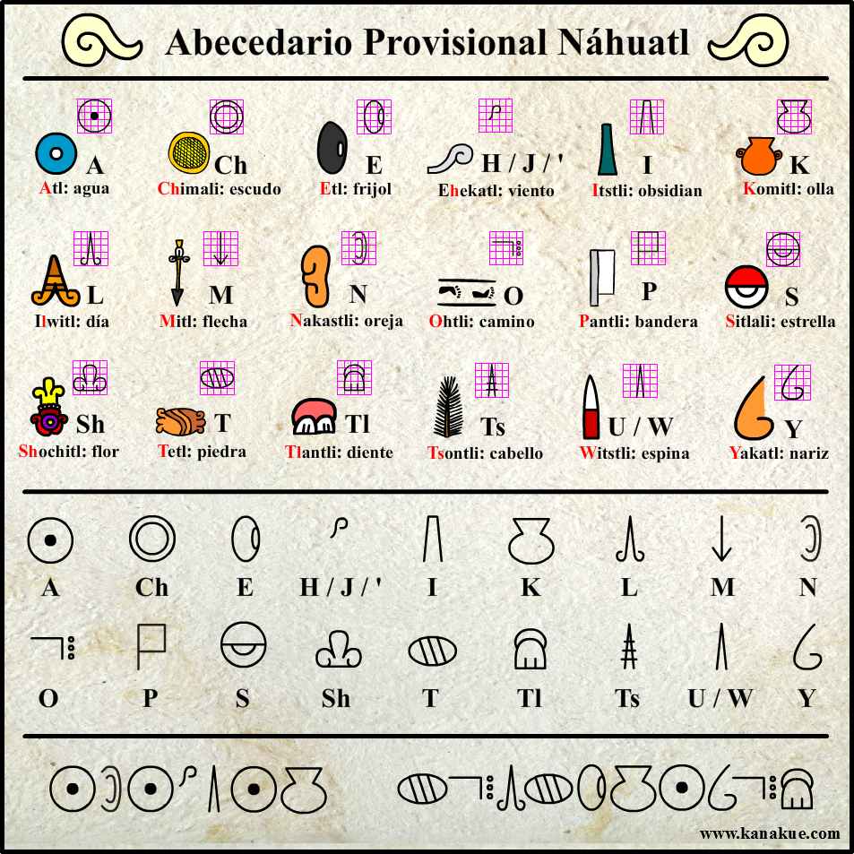

## Contexto histórico y tecnológico

### El alfabeto náhuatl y la preservación del patrimonio documental

El náhuatl es una de las lenguas originarias más importantes de Mesoamérica, con una tradición escrita que se remonta a siglos antes de la llegada de los españoles. Originalmente, los escribas nahuas (llamados *tlacuilos*) empleaban un sistema logográfico y pictográfico altamente estructurado para registrar información histórica, tributaria y ceremonial en códices. Tras la conquista, se desarrolló una adaptación del alfabeto latino que incorporaba convenciones ortográficas específicas para representar la fonología propia de la lengua.

En la actualidad, han surgido propuestas de **sistemas de escritura intermedios** que buscan establecer un puente pedagógico y visual entre la tradición glífica ancestral y la escritura alfabética moderna. Un ejemplo representativo es el *Abecedario Provisional Náhuatl* (ver @fig-nauatl), el cual asigna símbolos geométricos simplificados a los fonemas de la lengua, conservando la estética visual mesoamericana mientras facilita la transición hacia la lectoescritura.

{#fig-nauatl fig-align="center" width="500"}

{#fig-abcnauatl fig-align="center" width="500"}

La preservación de estos sistemas de escritura no se limita a la conservación física de los acervos, sino que exige su digitalización y análisis computacional para garantizar su accesibilidad y revitalización lingüística [@can2018]. Sin embargo, la transcripción manual por parte de especialistas es un proceso lento, costoso y propenso a errores humanos. En este contexto, el desarrollo de herramientas automatizadas de reconocimiento óptico resulta fundamental, aunque la naturaleza morfológica de estos glifos plantea desafíos matemáticos que superan los enfoques convencionales.

### El reto del reconocimiento óptico de caracteres en lenguas indígenas

El Reconocimiento Óptico de Caracteres (OCR, por sus siglas en inglés) ha alcanzado niveles de madurez notables en lenguas mayoritarias con alfabetos estandarizados [@lecun1998]. No obstante, su aplicación a sistemas de escritura indígenas, y particularmente a propuestas como el Abecedario Provisional Náhuatl, enfrenta obstáculos estructurales que trascienden la ingeniería de software y se adentran en la modelación matemática y el aprendizaje estadístico:

1.  **Variabilidad en la representación fonética:** A diferencia de un alfabeto latino estandarizado donde existe una correspondencia biunívoca estricta entre grafema y fonema, en las propuestas glíficas del náhuatl existe flexibilidad en la selección del pictograma base. Por ejemplo, para el fonema $/e/$, teóricamente se podría optar entre el glifo de *etl* (frijol) o el de *elotl* (elote), introduciendo ambigüedad ortográfica.

2.  **Falta de estandarización tipográfica:** No existe una fuente tipográfica digital oficial para estos sistemas. Cada material educativo, comunidad o institución emplea variantes estilísticas de los símbolos, lo que induce una alta dispersión en las proporciones geométricas que un algoritmo de clasificación debe procesar.

3.  **Ausencia de conjuntos de datos públicos:** Mientras que para el alfabeto latino o los dígitos arábigos existen repositorios masivos y curados —como MNIST o EMNIST [@cohen2017]—, los sistemas de escritura mesoamericanos carecen de bases de datos públicas etiquetadas. Esta escasez limita la aplicación directa de arquitecturas de aprendizaje profundo de alta capacidad.

4.  **Variabilidad morfológica en el trazo:** Incluso tras fijar la correspondencia entre fonema y glifo (por ejemplo, asignar el símbolo de *etl* al fonema $/e/$), el sistema debe ser invariante ante las variaciones locales en el grosor del trazo, la escala, la rotación y las deformaciones elásticas propias de la escritura manual o el deterioro documental.

### Delimitación del problema de investigación

Para abordar este fenómeno desde las matemáticas aplicadas, es indispensable acotar formalmente el alcance del estudio. Si bien la estandarización ortográfica (la elección lingüística entre *etl* o *elotl*) constituye un problema filológico relevante, su resolución excede los objetivos de esta tesis.

Por lo tanto, **este trabajo asume un repertorio ortográfico fijo y estandarizado**: los 18 grafemas del Abecedario Provisional Náhuatl ilustrados en la @fig-abcnauatl, bajo una correspondencia unívoca entre cada glifo y su etiqueta fonética. Bajo esta hipótesis, el problema se traslada íntegramente al dominio del **reconocimiento estadístico de patrones**, donde se contrastan dos paradigmas matemáticos fundamentales:

-   **Modelos Ocultos de Markov (HMM):** Que modelan la secuencia estocástica unidireccional de rasgos geométricos extraídos del trazo mediante procesos probabilísticos de estados latentes [@rabiner1989; @plotz2009].

-   **Redes Neuronales Convolucionales (CNN):** Que aprenden representaciones espaciales jerárquicas e invariantes topológicas directamente sobre el tensor de píxeles mediante optimización no lineal [@lecun1998].

## Planteamiento del Problema

El reconocimiento automático de patrones en sistemas de escritura no estandarizados presenta retos que exceden las capacidades de los algoritmos de OCR clásicos. Al centrar el estudio en los glifos del alfabeto náhuatl, el problema de investigación se formula desde la modelación matemática y el aprendizaje automático a partir de dos ejes de complejidad: la geometría morfológica de los caracteres y la dicotomía entre los paradigmas de modelado generativo secuencial y discriminativo tensorial.

### Limitaciones de los enfoques tradicionales ante alta variabilidad morfológica

Los sistemas de OCR clásicos asumen la existencia de una tipografía subyacente rígida para cada clase. En el alfabeto latino, la varianza intra-clase entre distintas instancias de un mismo carácter es acotada y puede absorberse mediante transformaciones afines simples.

Por el contrario, los glifos del sistema provisional náhuatl poseen una estructura pictográfica compuesta por trazos curvos, bucles cerrados y puntos diacríticos aislados (como en los grafemas correspondientes a las sílabas *Tl* o *Ts*). Al carecer de una tipografía estándar, cada instancia presenta fluctuaciones severas en curvatura, proporción y conectividad de trazo.

Matemáticamente, esto se traduce en distribuciones de probabilidad en el espacio de características con una varianza intra-clase elevada y fuertemente multimodal. Los métodos tradicionales basados en correlación de plantillas (*template matching*) o descriptores geométricos rígidos fracasan al no poder generalizar sobre dicha dispersión. Asimismo, la degradación física de los documentos (ruido aditivo de alta frecuencia, manchas y sangrado de tinta) introduce incertidumbre en los contornos, exigiendo modelos intrínsecamente robustos al ruido y a las perturbaciones locales.

### La dicotomía matemática: Modelos Generativos Secuenciales (HMM) vs. Modelos Discriminativos Tensoriales (CNN)

Para abordar esta variabilidad morfológica, la teoría del reconocimiento de patrones ofrece dos marcos matemáticos estructuralmente opuestos [@plotz2009; @lecun1998]:

1.  **El enfoque estocástico y secuencial (Modelos Ocultos de Markov - HMM):** Los HMM conciben el glifo no como una matriz estática, sino como la realización observable de un proceso estocástico secuencial de izquierda a derecha [@plotz2009]. Al proyectar la imagen bidimensional mediante ventanas deslizantes hacia una secuencia unidimensional de vectores de rasgos estructurales (como momentos de primer orden, perfiles de proyección y transiciones de tinta), el modelo estima matrices de transición y distribuciones de emisión para capturar la evolución espacial del trazo.
    -   *Ventaja matemática:* Poseen una fundamentación axiomática en la teoría de la probabilidad [@rabiner1989], permiten cuantificar la incertidumbre de clasificación y ofrecen alta interpretabilidad estructural al imponer restricciones topológicas como el modelo de Bakis.
    -   *Limitación:* Dependen críticamente de la *ingeniería manual de características*. La proyección de $\mathbb{R}^{H \times W}$ a una secuencia temporal de longitud $T$ conlleva una pérdida irreversible de información topológica bidimensional, y la estimación de los parámetros de emisión sufre la maldición de la dimensionalidad si el espacio de rasgos crece sin restricción.
2.  **El enfoque de optimización en espacios tensoriales (Redes Neuronales Convolucionales - CNN):** Las CNN abordan la clasificación desde el análisis funcional y el álgebra multilineal en espacios de alta dimensión. Al representar cada glifo como un tensor $X \in \mathbb{R}^{H \times W \times C}$, aplican operadores de convolución discreta (productos internos locales) que aprenden de manera endógena bancos de filtros detectores de características jerárquicas [@lecun1998].
    -   *Ventaja matemática:* Mediante la compartición espacial de pesos y los operadores de submuestreo (*pooling*), exhiben equivarianza por traslación e invarianza aproximada ante deformaciones locales, eliminando la extracción heurística de rasgos.
    -   *Limitación:* Operan como aproximadores universales de baja interpretabilidad ("caja negra") y requieren volúmenes elevados de datos etiquetados para ajustar sus parámetros mediante descenso de gradiente sin incurrir en sobreajuste.

### Formulación del problema de investigación

Dada la escasez de acervos digitales etiquetados en lenguas originarias —lo cual penaliza la capacidad de generalización de las CNN— y la complejidad topológica bidimensional de los glifos —que penaliza a los HMM por la serialización de sus rasgos—, no existe un consenso teórico sobre qué arquitectura matemática resulta óptima para este dominio.

En consecuencia, el problema central de esta tesis consiste en determinar, mediante un protocolo experimental controlado, **cuál de estos dos paradigmas matemáticos —la inferencia probabilística secuencial (HMM) o la optimización no lineal en espacios tensoriales (CNN)— alcanza un mejor compromiso entre exactitud de clasificación, eficiencia computacional, estabilidad estadística e interpretabilidad** para el reconocimiento de glifos del alfabeto náhuatl.

## Justificación desde las Matemáticas Aplicadas

La comparación sistemática entre Modelos Ocultos de Markov y Redes Neuronales Convolucionales para la clasificación de glifos náhuatl se sustenta en tres ejes fundamentales de las matemáticas aplicadas:

### Inferencia estocástica vs. Optimización en espacios tensoriales

El paradigma de los HMM formula el reconocimiento de patrones desde la **teoría de la probabilidad y los procesos estocásticos**. El glifo se interpreta como una trayectoria observada generada por una cadena de Markov latente. La calibración del modelo se plantea como un problema de estimación por máxima verosimilitud resuelto mediante el algoritmo de *Expectation-Maximization* (Baum-Welch) [@rabiner1989], mientras que la clasificación se ejecuta evaluando la verosimilitud marginal o la trayectoria óptima de estados. Su rigor radica en la capacidad de modelar explícitamente la incertidumbre estocástica inherente a trazos ruidosos o degradados.

En contraste, el paradigma de las CNN se enmarca en la **optimización no lineal y la composición de operadores en espacios de alta dimensión**. Modelando la entrada como un tensor $X \in \mathbb{R}^{H \times W \times C}$, el aprendizaje se formula como la minimización empírica de una funcional de pérdida (entropía cruzada) mediante variantes estocásticas del flujo de gradiente [@lecun1998]. Su justificación reside en su capacidad para construir representaciones invariantes mediante composiciones sucesivas de operadores lineales locales y funciones de activación no lineales.

### Tratamiento de la dimensionalidad e invarianza geométrica

Un aspecto crítico en el análisis matemático de glifos es el manejo de la dimensionalidad y las acciones de grupos de transformación geométrica (traslaciones, rotaciones y escalamientos).

Los HMM exigen reducir la dimensionalidad espacial mediante un mapeo que proyecta la matriz de píxeles en una secuencia temporal de características discretizadas o de baja dimensión ($\mathbb{R}^T$). Este proceso sacrifica vecindades verticales y horizontales simultáneas, obligando a compensar dicha pérdida mediante descriptores geométricos invariantes a traslación (como el centroide de masa o la envoltura convexa del trazo).

Por el contrario, las CNN preservan la estructura topológica del dominio bidimensional en todas sus capas intermedias. La compartición de parámetros en los kernels convolucionales induce de manera natural la propiedad de **equivarianza frente a traslaciones**, mientras que el submuestreo espacial (*pooling*) aporta invarianza local ante pequeñas distorsiones elásticas. Contrastar ambas estrategias permite cuantificar el costo real de la reducción dimensional en caracteres con geometría compleja.

### Interpretabilidad matemática, escasez de datos y cuantificación de incertidumbre

Finalmente, la investigación se justifica por las restricciones propias del dominio de estudio: al tratarse de un sistema de escritura indígena sin repositorios masivos, el modelado debe operar bajo condiciones de **escasez de datos originales**, mitigadas mediante aumentación sintética controlada.

Los HMM, al poseer un espacio paramétrico acotado y gobernado por restricciones estructurales fuertes —como la **topología unidireccional de Bakis**, donde las transiciones solo avanzan hacia estados posteriores o permanecen en el mismo estado—, presentan menor varianza de estimación con muestras reducidas y permiten interpretar directamente la dinámica espacial del glifo a través de su matriz de transición. Adicionalmente, la integración de esquemas de remuestreo **bootstrap** [@efron1994] permite construir intervalos de confianza no paramétricos sobre el desempeño del clasificador y evaluar la estabilidad de sus parámetros.

Por su parte, las CNN contienen decenas de miles de parámetros libres, lo que las vuelve susceptibles al sobreajuste cuando la diversidad de plantillas base es limitada, exigiendo técnicas explícitas de regularización (como *Dropout* espacial y penalización de pesos) y aumentación en línea.

De este modo, esta tesis aporta a las matemáticas aplicadas un marco riguroso para evaluar la compensación (*trade-off*) entre **capacidad representacional, estabilidad estadística, costo computacional e interpretabilidad**, sentando bases metodológicas replicables para la preservación digital de sistemas de escritura originarios.