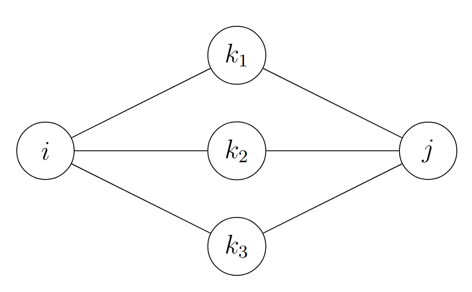
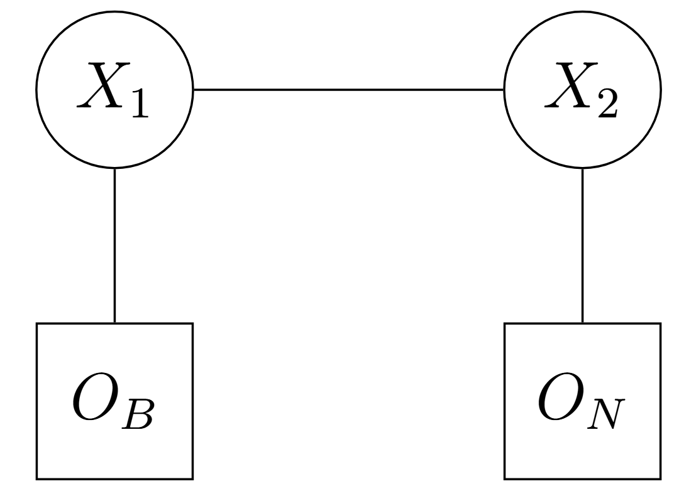

## Teoría de la Medida y Procesos Estocásticos

Para construir de manera axiomática una Cadena de Markov a Tiempo Continuo (CTMC) y su posterior discretización hacia un Modelo Oculto de Markov (HMM), partimos de los fundamentos de la teoría de la medida y la probabilidad moderna [@rudin1987]. Se asume que el lector posee familiaridad previa con los conceptos de $\sigma$-álgebra, funciones medibles, integración de Lebesgue y esperanza condicional.

### Espacios de probabilidad filtrados

En el modelado de fenómenos estocásticos que evolucionan a lo largo de un parámetro continuo (ya sea temporal o, en nuestro caso, un eje espacial de barrido horizontal sobre un glifo), resulta indispensable formalizar cómo se acumula la información disponible conforme avanza dicho parámetro.

::: {#def-espacio-probabilidad}
### Espacio de probabilidad

Un **espacio de probabilidad** es una terna $(\Omega, \mathcal{F}, \mathbb{P})$, donde:

1. $\Omega$ es un conjunto no vacío denominado *espacio muestral*, cuyos elementos $\omega \in \Omega$ representan resultados elementales o realizaciones completas del fenómeno aleatorio (por ejemplo, una instancia particular de un glifo manuscrito sometido a ruido).
2. $\mathcal{F} \subseteq \mathcal{P}(\Omega)$ es una **$\sigma$-álgebra** de subconjuntos de $\Omega$ (denominados *eventos*), cerrada bajo complementos y uniones numerables, con $\Omega \in \mathcal{F}$.
3. $\mathbb{P}: \mathcal{F} \to [0, 1]$ es una **medida de probabilidad**, es decir, una función de conjunto numerablemente aditiva ($\sigma$-aditiva) tal que $\mathbb{P}(\emptyset) = 0$ y $\mathbb{P}(\Omega) = 1$.
:::

::: {#def-espacio-filtrado}
### Filtración y espacio de probabilidad filtrado

Sea $(\Omega, \mathcal{F}, \mathbb{P})$ un espacio de probabilidad. Una **filtración** $\mathbb{F} = \{\mathcal{F}_t\}_{t \ge 0}$ es una familia no decreciente de sub-$\sigma$-álgebras de $\mathcal{F}$, es decir, una colección que satisface:

$$
\mathcal{F}_s \subseteq \mathcal{F}_t \subseteq \mathcal{F} \qquad \text{para todo } 0 \le s < t.
$$

La cuádrupla $(\Omega, \mathcal{F}, \mathbb{F}, \mathbb{P})$ se denomina **espacio de probabilidad filtrado**. Intuitivamente, $\mathcal{F}_t$ codifica toda la información histórica observable hasta el instante o posición espacial $t$.
:::

::: {#def-espacio-discreto}
### Espacio de estados discreto

Definimos el **espacio de estados** $S$ como un conjunto discreto y finito de cardinalidad $N = |S| < \infty$. Al dotar a $S$ de la topología discreta, su $\sigma$-álgebra de Borel coincide con su conjunto potencia $\mathcal{S} = \mathcal{P}(S)$, por lo que todo subconjunto de $S$ es medible.

En el contexto del reconocimiento de glifos del alfabeto náhuatl, $S$ admite dos niveles de interpretación física:

- **Nivel microscópico (píxel):** $S$ representa el conjunto finito de intensidades verdaderas de un píxel (por ejemplo, $S = \{B, N\}$ en imágenes binarias o $S = \{0, 1, \dots, 255\}$ en escala de grises).
- **Nivel macroscópico (estructura del carácter):** $S = \{1, 2, \dots, N\}$ indexa las fases estructurales latentes consecutivas que componen la morfología de un glifo al ser recorrido de izquierda a derecha.
:::

### Definición formal de Procesos a Tiempo Continuo

::: {#def-proceso-estocastico}
### Proceso estocástico a Tiempo Continuo

Un **proceso estocástico a tiempo continuo** con espacio de estados discreto $S$ es una familia indexada de variables aleatorias

$$
X = \{X(t) : t \in \mathbb{R}_{\ge 0}\},
$$

definidas sobre un espacio de probabilidad común $(\Omega, \mathcal{F}, \mathbb{P})$, tales que para cada $t \ge 0$, la aplicación $X(t): \Omega \to S$ es $\mathcal{F}$-medible; esto es, $X(t)^{-1}(B) \in \mathcal{F}$ para todo $B \in \mathcal{P}(S)$.

Se dice además que el proceso $X$ está **adaptado** a la filtración $\mathbb{F} = \{\mathcal{F}_t\}_{t \ge 0}$ si $X(t)$ es $\mathcal{F}_t$-medible para cada $t \ge 0$. Para cada realización fija $\omega \in \Omega$, la función $t \mapsto X(t)(\omega)$ se denomina *trayectoria* del proceso.
:::

En nuestro marco de estudio, la trayectoria $X(t)$ representa la evolución del estado estructural ideal (libre de ruido) del glifo a lo largo de un parámetro continuo de recorrido $t \in [0, T]$.

## Cadenas de Markov a Tiempo Continuo (CTMC)

La transición desde un proceso estocástico general hacia una Cadena de Markov a Tiempo Continuo (CTMC) se establece imponiendo una restricción estructural sobre la dependencia temporal del sistema [@norris1998].

### La propiedad de amnesia (Markoviana)

La propiedad markoviana establece que, condicionado al estado presente del sistema, su evolución futura es estocásticamente independiente de toda su historia pasada.

::: {#def-propiedad-markov}
### Propiedad de Markov en tiempo continuo

Un proceso estocástico adaptado $X = \{X(t)\}_{t \ge 0}$ con espacio de estados discreto $S$ sobre $(\Omega, \mathcal{F}, \mathbb{F}, \mathbb{P})$ es una **Cadena de Markov a Tiempo Continuo (CTMC)** si para cualquier colección finita de instantes

$$
0 \le t_1 < t_2 < \dots < t_n < s < t
$$

y cualquier elección de estados $i_1, i_2, \dots, i_n, i, j \in S$ con $\mathbb{P}(X(t_1)=i_1, \dots, X(t_n)=i_n, X(s)=i) > 0$, se cumple:

$$
\mathbb{P}\bigl(X(t) = j \mid X(t_1) = i_1, \dots, X(t_n) = i_n, X(s) = i\bigr)
=
\mathbb{P}\bigl(X(t) = j \mid X(s) = i\bigr).
$$ {#eq-propiedad-markov}

De manera equivalente y más compacta en términos de probabilidad condicional respecto a la filtración $\mathbb{F}$:

$$
\mathbb{P}(X(t) = j \mid \mathcal{F}_s)
=
\mathbb{P}(X(t) = j \mid X(s))
\quad \text{casi seguramente (c.s.),}
$$

para todo $0 \le s \le t$ y todo $j \in S$.
:::

::: {#def-probabilidad-transicion-homogeneidad}
### Probabilidades de transición y homogeneidad temporal

Para cualesquiera $0 \le s \le t$ e $i, j \in S$, definimos la **probabilidad de transición** del estado $i$ al estado $j$ en el intervalo $[s, t]$ como:

$$
p_{ij}(s, t) = \mathbb{P}\bigl(X(t) = j \mid X(s) = i\bigr).
$$

Se dice que la CTMC es **homogénea** si $p_{ij}(s, t)$ depende únicamente de la longitud $\tau = t - s$ del intervalo y no del instante inicial $s$. En tal caso, denotamos:

$$
p_{ij}(\tau) = \mathbb{P}\bigl(X(s + \tau) = j \mid X(s) = i\bigr) \qquad \forall\, s \ge 0,\; \tau \ge 0.
$$

Agrupando estas probabilidades para todos los pares $(i, j) \in S \times S$, obtenemos la **matriz de transición** $P(\tau) = [p_{ij}(\tau)]_{i,j \in S}$, la cual es una matriz estocástica para todo $\tau \ge 0$; es decir:

$$
p_{ij}(\tau) \ge 0 \quad \forall\, i, j \in S \qquad \text{y} \qquad \sum_{j \in S} p_{ij}(\tau) = 1 \quad \forall\, i \in S.
$$
:::

### Matriz Generadora Infinitesimal $Q$ y Ecuaciones de Kolmogorov

Para caracterizar la dinámica local de una CTMC homogénea en intervalos infinitesimalmente pequeños $h \to 0^+$, se introduce el concepto de matriz generadora [@norris1998]. Suponemos que la familia $\{P(t)\}_{t \ge 0}$ es *estándar*, es decir, $\lim_{t \to 0^+} P(t) = I$, donde $I$ denota la matriz identidad de orden $N$.

::: {#def-matriz-generadora}
### Matriz generadora infinitesimal ($Q$)

Asumiendo que las funciones $t \mapsto p_{ij}(t)$ son diferenciables por la derecha en $t = 0$, definimos la **tasa instantánea de transición** $q_{ij}$ del estado $i$ al estado $j$ (para $i \neq j$) como:

$$
q_{ij} = \lim_{h \to 0^+} \frac{p_{ij}(h)}{h} \ge 0.
$$ {#eq-tasa-transicion}

Para los elementos diagonales ($i = j$), definimos la **tasa de salida** del estado $i$ como $v_i = -q_{ii}$, dada por:

$$
q_{ii} = \lim_{h \to 0^+} \frac{p_{ii}(h) - 1}{h} = \lim_{h \to 0^+} \frac{-\sum_{j \neq i} p_{ij}(h)}{h} = -\sum_{j \neq i} q_{ij} \le 0.
$$ {#eq-tasa-salida}

La matriz $Q = [q_{ij}]_{i,j \in S}$ de dimensión $N \times N$ recibe el nombre de **matriz generadora infinitesimal** (o matriz $Q$) de la cadena, y satisface la propiedad conservativa de suma nula por filas:

$$
\sum_{j \in S} q_{ij} = 0 \qquad \forall\, i \in S.
$$
:::

A partir de la matriz $Q$ y de la propiedad de Markov, es posible derivar un sistema acoplado de ecuaciones diferenciales ordinarias que gobierna la evolución de $P(t)$ para todo $t \ge 0$.

::: {#imp-ecuaciones-kolmogorov}
### Ecuaciones diferenciales de Kolmogorov

Bajo condiciones de regularidad (satisfechas automáticamente cuando el espacio de estados $S$ es finito), la familia de matrices de transición $\{P(t)\}_{t \ge 0}$ es diferenciable para todo $t > 0$ y constituye la solución única a los dos sistemas siguientes [@norris1998]:

1. **Ecuaciones progresivas de Kolmogorov (*Forward*):**
   $$
   \frac{d}{dt} P(t) = P(t)Q, \qquad \text{o componente a componente,} \qquad p'_{ij}(t) = \sum_{k \in S} p_{ik}(t) q_{kj}.
   $$ {#eq-kolmogorov-forward}

2. **Ecuaciones regresivas de Kolmogorov (*Backward*):**
   $$
   \frac{d}{dt} P(t) = Q P(t), \qquad \text{o componente a componente,} \qquad p'_{ij}(t) = \sum_{k \in S} q_{ik} p_{kj}(t).
   $$ {#eq-kolmogorov-backward}

Ambas ecuaciones están sujetas a la condición inicial $P(0) = I$.
:::

### La matriz exponencial $P(t) = e^{Qt}$ como semigrupo de operadores

La relación fundamental entre las probabilidades de transición en distintos horizontes temporales viene dada por las ecuaciones de Chapman-Kolmogorov.

::: {#imp-chapman-kolmogorov}
### Ecuaciones de Chapman-Kolmogorov y propiedad de semigrupo

Para cualesquiera tiempos $s, t \ge 0$ e índices $i, j \in S$, condicionando respecto al estado intermedio $X(s) = k$ y aplicando la propiedad de Markov (@eq-propiedad-markov), se obtiene:

$$
p_{ij}(t + s) = \sum_{k \in S} p_{ik}(t)\, p_{kj}(s).
$$ {#eq-chapman}

En forma matricial, esto expresa que la familia de operadores lineales $\{P(t)\}_{t \ge 0}$ conforma un **semigrupo de operadores estocásticos** de un parámetro sobre $\mathbb{R}^N$:

$$
P(t + s) = P(t)P(s) \quad \forall\, s, t \ge 0, \qquad \text{con } P(0) = I.
$$
:::

{#fig-chapman fig-align="center" width="550"}

Al resolver las ecuaciones diferenciales de Kolmogorov (@eq-kolmogorov-forward y @eq-kolmogorov-backward) sobre el espacio de matrices finitas $\mathbb{R}^{N \times N}$, la solución explícita única viene dada por la **exponencial matricial** [@norris1998]:

$$
P(t) = e^{Qt} := \sum_{n=0}^{\infty} \frac{(Qt)^n}{n!} = I + Qt + \frac{Q^2 t^2}{2!} + \frac{Q^3 t^3}{3!} + \cdots
$$ {#eq-exponencial-matricial}

La serie de potencias (@eq-exponencial-matricial) converge absolutamente para todo $t \in \mathbb{R}$ y garantiza tanto la propiedad de semigrupo $e^{Q(t+s)} = e^{Qt}e^{Qs}$ como la conservación de la estocasticidad de $P(t)$ para todo $t \ge 0$.

#### Discretización espacial hacia la cadena embebida

En el análisis computacional de imágenes de glifos náhuatl, el dominio espacial se muestrea mediante una ventana deslizante vertical a pasos constantes $\Delta t = 1$ (correspondientes al *stride* horizontal). Evaluando el semigrupo $P(t)$ en los instantes discretos $t_k = k\Delta t$ ($k = 1, 2, \dots, T$), se induce una Cadena de Markov a Tiempo Discreto $\{X_k\}_{k=1}^T$ cuya matriz de transición de un paso es invariante:

$$
A = P(\Delta t) = e^{Q\Delta t} = [a_{ij}]_{i,j \in S}, \qquad \text{donde } a_{ij} = \mathbb{P}(X_{k+1} = j \mid X_k = i).
$$ {#eq-discretizacion-cadena}

Esta relación establece el puente formal entre la formulación continua basada en tasas infinitesimales $Q$ y su implementación algorítmica sobre secuencias discretas de longitud finita $T$.

## Modelos Ocultos de Markov Categóricos

En problemas reales de reconocimiento óptico de caracteres, el estado estructural verdadero del trazo no es accesible directamente; únicamente disponemos de mediciones discretas extraídas de imágenes sujetas a ruido, variaciones caligráficas y degradación documental. Para modelar esta incertidumbre de observación, se acopla la cadena de Markov latente con un proceso de emisión observable [@rabiner1989].

### Proceso latente vs. Proceso de observación empírica

La arquitectura de un Modelo Oculto de Markov (HMM) se fundamenta en un proceso estocástico bivariado $(X, Y)$ definido sobre $(\Omega, \mathcal{F}, \mathbb{P})$:

1. **Proceso latente e inobservable:** Está constituido por la cadena de Markov $X = \{X(t)\}_{t \ge 0}$ (o su versión muestreada $\{X_k\}_{k=1}^T$) sobre el espacio finito de estados ocultos $S = \{1, \dots, N\}$, gobernada por una distribución inicial $\pi = (\pi_1, \dots, \pi_N)$ con $\pi_i = \mathbb{P}(X_1 = i)$ y por el generador $Q$ (o matriz discreta $A = e^{Q\Delta t}$). Cada variable $X_k$ representa la fase morfológica latente del glifo en la $k$-ésima ventana espacial.

2. **Proceso de observación empírica:** Sea $O = \{v_1, v_2, \dots, v_M\}$ un alfabeto finito de $M$ símbolos categóricos observables (en nuestra metodología, $M = 256$ categorías resultantes de cuantificar y codificar en 8 bits los descriptores geométricos de cada ventana). Se postula un proceso acoplado $Y = \{Y_k\}_{k=1}^T$, donde cada variable aleatoria $Y_k : \Omega \to O$ representa el símbolo discreto registrado en la $k$-ésima ventana.

### Independencia condicional y Matriz de Emisión $E$

La vinculación probabilística entre los estados latentes y las observaciones empíricas queda completamente determinada por el supuesto de independencia condicional instantánea [@rabiner1989].

::: {#def-independencia-emision}
### Condición de independencia local y Matriz de Emisión

Dado el estado oculto concurrente $X_k$, la observación $Y_k$ es condicionalmente independiente de toda la historia previa (y futura) tanto de los estados latentes como de las observaciones anteriores. Formalmente, denotando por $\mathcal{F}_k^X = \sigma(X_1, \dots, X_k)$ y $\mathcal{F}_{k-1}^Y = \sigma(Y_1, \dots, Y_{k-1})$ las filtraciones generadas por ambos procesos, se cumple:

$$
\mathbb{P}\bigl(Y_k = y \mid \mathcal{F}_k^X, \mathcal{F}_{k-1}^Y\bigr)
=
\mathbb{P}\bigl(Y_k = y \mid X_k = x\bigr)
\quad \text{c.s.}
$$ {#eq-matrizemision}

para todo $k \in \{1, \dots, T\}$, todo estado $x \in S$ y todo símbolo observable $y \in O$.

Estas probabilidades definen la **matriz de emisión estocástica** $E = [e_{xm}]$ de dimensión $N \times M$, cuyas entradas están dadas por:

$$
e_{xm} = \mathbb{P}(Y_k = v_m \mid X_k = x), \qquad \text{sujetas a } e_{xm} \ge 0 \quad \text{y} \quad \sum_{m=1}^{M} e_{xm} = 1 \quad \forall\, x \in S.
$$
:::

::: {#def-hmm-categorico}
### Modelo Oculto de Markov Categórico (Discreto)

Un **Modelo Oculto de Markov Categórico** queda completamente especificado por la terna de parámetros

$$
\lambda = (\pi, A, E) \qquad \bigl(\text{o equivalentemente } \lambda = (\pi, Q, E) \text{ en tiempo continuo}\bigr),
$$

donde $\pi \in \mathbb{R}^N$ es el vector de probabilidades iniciales, $A \in \mathbb{R}^{N \times N}$ es la matriz de probabilidades de transición entre estados latentes y $E \in \mathbb{R}^{N \times M}$ es la matriz de probabilidades de emisión de símbolos categóricos.
:::

## Algoritmos de Inferencia y Decodificación

Dado un modelo calibrado $\lambda_c$ asociado a la $c$-ésima clase de glifo del alfabeto náhuatl y una secuencia observada $Y = (y_1, y_2, \dots, y_T) \in O^T$ extraída de una imagen de prueba, surgen dos problemas fundamentales de inferencia estadística [@rabiner1989]:

1. **Problema de evaluación (Filtrado y verosimilitud):** Calcular la verosimilitud marginal $\mathbb{P}(Y \mid \lambda_c)$ para clasificar el glifo mediante la regla de máxima verosimilitud $\hat{c} = \arg\max_{c} \mathbb{P}(Y \mid \lambda_c)$.
2. **Problema de decodificación:** Encontrar la secuencia óptima de estados ocultos $\hat{X} = (\hat{x}_1, \dots, \hat{x}_T)$ que mejor explica las observaciones.

### El Algoritmo Forward-Backward (Filtrado y Suavizado)

El cálculo directo de $\mathbb{P}(Y \mid \lambda)$ sumando sobre todas las posibles trayectorias latentes $X \in S^T$ requiere $\mathcal{O}(2T N^T)$ operaciones, lo cual es computacionalmente intratable. El algoritmo **Forward-Backward** reduce esta complejidad a $\mathcal{O}(N^2 T)$ mediante programación dinámica [@rabiner1989].

#### Procedimiento Forward (Filtrado)

Definimos la **variable de avance (*forward*)** $\alpha_k(i)$ como la probabilidad conjunta de haber observado la secuencia parcial $(y_1, \dots, y_k)$ y encontrarse en el estado latente $i \in S$ en el paso $k$:

$$
\alpha_k(i) = \mathbb{P}(Y_1 = y_1, \dots, Y_k = y_k, X_k = i \mid \lambda).
$$

Esta cantidad se calcula recursivamente en tres etapas:

1. **Inicialización ($k = 1$):**
   $$
   \alpha_1(i) = \pi_i \, e_{i, y_1}, \qquad \forall\, i \in S.
   $$
2. **Inducción ($k = 2, \dots, T$):** Empleando la ecuación de Chapman-Kolmogorov (@eq-chapman) y la independencia de emisión (@eq-matrizemision):
   $$
   \alpha_k(j) = \left(\sum_{i=1}^{N} \alpha_{k-1}(i)\, p_{ij}(\Delta t_k)\right) e_{j, y_k}, \qquad \forall\, j \in S,
   $$ {#eq-forward-recursion}
   donde $p_{ij}(\Delta t_k) = [e^{Q\Delta t_k}]_{ij}$ (que se reduce a $a_{ij}$ en pasos unitarios).
3. **Terminación:** La verosimilitud marginal total de la secuencia observada se obtiene marginalizando sobre el estado final:
   $$
   \mathbb{P}(Y \mid \lambda) = \sum_{i=1}^{N} \alpha_T(i).
   $$ {#eq-verosimilitud-total}

#### Procedimiento Backward (Suavizado)

De manera simétrica, definimos la **variable de retroceso (*backward*)** $\beta_k(i)$ como la probabilidad condicional de observar la secuencia futura $(y_{k+1}, \dots, y_T)$ dado que el sistema se encuentra en el estado $i \in S$ en el paso $k$:

$$
\beta_k(i) = \mathbb{P}(Y_{k+1} = y_{k+1}, \dots, Y_T = y_T \mid X_k = i, \lambda).
$$

Su cálculo recursivo procede de derecha a izquierda:

1. **Inicialización ($k = T$):**
   $$
   \beta_T(i) = 1, \qquad \forall\, i \in S.
   $$
2. **Inducción ($k = T-1, T-2, \dots, 1$):**
   $$
   \beta_k(i) = \sum_{j=1}^{N} p_{ij}(\Delta t_{k+1})\, e_{j, y_{k+1}}\, \beta_{k+1}(j), \qquad \forall\, i \in S.
   $$ {#eq-backward-recursion}

Combinando ambas variables mediante el teorema de Bayes, se obtiene la **probabilidad posterior suavizada** $\gamma_k(i)$ de ocupar el estado $i$ en el instante $k$ dada la secuencia completa $Y$:

$$
\gamma_k(i) = \mathbb{P}(X_k = i \mid Y, \lambda) = \frac{\alpha_k(i)\,\beta_k(i)}{\mathbb{P}(Y \mid \lambda)} = \frac{\alpha_k(i)\,\beta_k(i)}{\sum_{j=1}^{N} \alpha_k(j)\,\beta_k(j)}.
$$ {#eq-gamma-posterior}

#### Ejemplo ilustrativo del algoritmo Forward--Backward

Para concretar el funcionamiento de las ecuaciones anteriores en el análisis de imágenes, consideremos un píxel cuya intensidad verdadera puede encontrarse en uno de dos estados ocultos $S = \{B, N\}$, donde $B$ denota un píxel verdaderamente blanco y $N$ un píxel verdaderamente negro.

Debido al ruido de digitalización, la lectura empírica puede diferir del estado real. Supongamos una dinámica discretizada ($\Delta t = 1$) gobernada por la matriz de transición

$$
P = \begin{pmatrix} 0.8 & 0.2 \\ 0.3 & 0.7 \end{pmatrix},
$$

donde $p_{BN} = 0.2$ es la probabilidad de transitar de blanco a negro, y una matriz de emisión sobre el alfabeto observable $O = \{O_B, O_N\}$:

$$
E = \begin{pmatrix} 0.9 & 0.1 \\ 0.2 & 0.8 \end{pmatrix},
$$

con $e_{B, O_B} = \mathbb{P}(O_B \mid B) = 0.9$ y $e_{N, O_B} = \mathbb{P}(O_B \mid N) = 0.2$. Asumiendo una distribución inicial $\pi = (0.6, 0.4)$ y la secuencia observada $Y = (O_B, O_N)$:

- **Cálculo Forward:** Para la primera observación $O_B$:
  $$
  \alpha_1(B) = 0.6(0.9) = 0.54, \qquad \alpha_1(N) = 0.4(0.2) = 0.08.
  $$
  Para la segunda observación $O_N$, aplicando (@eq-forward-recursion):
  $$
  \alpha_2(B) = \bigl[0.54(0.8) + 0.08(0.3)\bigr](0.1) = 0.456(0.1) = 0.0456,
  $$
  $$
  \alpha_2(N) = \bigl[0.54(0.2) + 0.08(0.7)\bigr](0.8) = 0.164(0.8) = 0.1312.
  $$
  La verosimilitud total (@eq-verosimilitud-total) es $\mathbb{P}(Y) = 0.0456 + 0.1312 = 0.1768$.

- **Cálculo Backward:** Partiendo de $\beta_2(B) = \beta_2(N) = 1$ y aplicando (@eq-backward-recursion):
  $$
  \beta_1(B) = 0.8(0.1)(1) + 0.2(0.8)(1) = 0.24, \qquad \beta_1(N) = 0.3(0.1)(1) + 0.7(0.8)(1) = 0.59.
  $$

- **Inferencia posterior:** Aplicando (@eq-gamma-posterior) en $k = 1$:
  $$
  \gamma_1(B) = \frac{0.54(0.24)}{0.1768} \approx 0.733, \qquad \gamma_1(N) = \frac{0.08(0.59)}{0.1768} \approx 0.267.
  $$

A pesar de registrarse una transición ruidosa de blanco a negro, el modelo pondera la evidencia sensorial con la inercia de la matriz $P$ para inferir una probabilidad posterior de aproximadamente $73.3\%$ de que el color verdadero inicial haya sido blanco.

{#fig-pixelbn fig-align="center" width="200"}

### Programación Dinámica: El Algoritmo de Viterbi

Mientras que la ecuación (@eq-gamma-posterior) maximiza la probabilidad marginal de cada estado individualmente, en el análisis estructural de glifos suele requerirse la trayectoria completa más probable $\hat{X} = (\hat{x}_1, \dots, \hat{x}_T)$ que maximice la probabilidad condicional conjunta [@rabiner1989]:

$$
\hat{X} = \arg\max_{x_1, \dots, x_T} \mathbb{P}(X_1 = x_1, \dots, X_T = x_T \mid Y_1 = y_1, \dots, Y_T = y_T, \lambda).
$$

Dado que el denominador $\mathbb{P}(Y \mid \lambda)$ es constante respecto a $X$, esto equivale a maximizar la probabilidad conjunta $\mathbb{P}(X, Y \mid \lambda)$. El **Algoritmo de Viterbi** resuelve este problema mediante el principio de optimalidad de Bellman, sustituyendo la suma en (@eq-forward-recursion) por el operador máximo:

1. **Inicialización ($k = 1$):** Para cada $i \in S$, definimos la probabilidad máxima parcial $\delta_1(i)$ y el puntero de retroceso $\psi_1(i)$:
   $$
   \delta_1(i) = \pi_i \, e_{i, y_1}, \qquad \psi_1(i) = 0.
   $$
2. **Recursión ($k = 2, \dots, T$):**
   $$
   \delta_k(j) = \left(\max_{1 \le i \le N} \bigl[\delta_{k-1}(i)\, p_{ij}(\Delta t_k)\bigr]\right) e_{j, y_k}, \qquad \psi_k(j) = \arg\max_{1 \le i \le N} \bigl[\delta_{k-1}(i)\, p_{ij}(\Delta t_k)\bigr].
   $$ {#eq-viterbi-recursion}
3. **Terminación y reconstrucción (*Backtracking*):**
   $$
   \hat{x}_T = \arg\max_{1 \le i \le N} \delta_T(i), \qquad \hat{x}_k = \psi_{k+1}(\hat{x}_{k+1}) \quad \text{para } k = T-1, T-2, \dots, 1.
   $$

En la práctica computacional, para evitar el subdesbordamiento numérico (*underflow*) causado por el producto de probabilidades pequeñas en secuencias largas, (@eq-viterbi-recursion) se implementa en el dominio logarítmico sustituyendo productos por sumas de log-verosimilitudes.

## Estimación de Parámetros

En la aplicación práctica sobre el alfabeto náhuatl, los parámetros $\lambda = (\pi, Q, E)$ —o su equivalente discretizado $\lambda = (\pi, A, E)$— de cada clase de glifo son desconocidos y deben estimarse a partir de un conjunto de $R$ secuencias de entrenamiento $\mathcal{D}_c = \{Y^{(1)}, Y^{(2)}, \dots, Y^{(R)}\}$ mediante estimación por máxima verosimilitud:

$$
\hat{\lambda}_c = \arg\max_{\lambda} \sum_{r=1}^{R} \log \mathbb{P}(Y^{(r)} \mid \lambda).
$$

Dado que no existe una solución analítica cerrada debido a la naturaleza inobservable de los estados $X$, se recurre a métodos iterativos de optimización estocástica [@rabiner1989].

### El algoritmo de Expectation-Maximization (Baum-Welch)

El algoritmo de **Baum-Welch** es un caso particular del método *Expectation-Maximization* (EM) que garantiza el incremento monótono de la verosimilitud $\mathbb{P}(\mathcal{D}_c \mid \lambda^{(m)})$ en cada iteración $m$ hasta converger a un punto estacionario [@rabiner1989].

Para su formulación, definimos la probabilidad posterior conjunta de transitar del estado $i$ en el paso $k$ al estado $j$ en el paso $k+1$ dada toda la secuencia $Y$:

$$
\xi_k(i, j) = \mathbb{P}(X_k = i, X_{k+1} = j \mid Y, \lambda)
= \frac{\alpha_k(i)\, p_{ij}(\Delta t_{k+1})\, e_{j, y_{k+1}}\, \beta_{k+1}(j)}{\mathbb{P}(Y \mid \lambda)}.
$$ {#eq-xi-transicion}

Partiendo de una inicialización $\lambda^{(0)}$, cada iteración $m \to m+1$ alterna dos pasos:

- **Paso $E$ (*Expectation*):** Utilizando los parámetros vigentes $\lambda^{(m)}$, se ejecutan los algoritmos Forward (@eq-forward-recursion) y Backward (@eq-backward-recursion) para calcular las estadísticas suficientes esperadas $\gamma_k(i)$ y $\xi_k(i, j)$, construyendo la función auxiliar de verosimilitud logarítmica esperada:
  $$
  \mathcal{Q}(\lambda, \lambda^{(m)}) = \sum_{X} \mathbb{P}(X \mid Y, \lambda^{(m)}) \log \mathbb{P}(X, Y \mid \lambda).
  $$

- **Paso $M$ (*Maximization*):** Se maximiza $\mathcal{Q}(\lambda, \lambda^{(m)})$ respecto a $\lambda$ sujeto a las restricciones de normalización estocástica mediante multiplicadores de Lagrange:
  1. *Actualización de la distribución inicial:*
     $$
     \pi_i^{(m+1)} = \gamma_1(i).
     $$
  2. *Actualización de la dinámica de transición:* En la formulación continua, las tasas fuera de la diagonal de la matriz generadora $Q^{(m+1)}$ se actualizan como:
     $$
     q_{ij}^{(m+1)} = \frac{\sum_{k=1}^{T-1} \xi_k(i, j)}{\sum_{k=1}^{T-1} \gamma_k(i)\,\Delta t_k} \quad (i \neq j), \qquad q_{ii}^{(m+1)} = -\sum_{j \neq i} q_{ij}^{(m+1)},
     $$
     mientras que en la cadena embebida discretizada ($\Delta t = 1$) las probabilidades de transición resultan:
     $$
     a_{ij}^{(m+1)} = \frac{\sum_{k=1}^{T-1} \xi_k(i, j)}{\sum_{k=1}^{T-1} \gamma_k(i)}.
     $$ {#eq-em-transicion}
  3. *Actualización de la matriz de emisión categórica:* Para cada estado $i \in S$ y cada símbolo observable $v_m \in O$:
     $$
     e_{im}^{(m+1)} = \frac{\sum_{k=1}^{T} \gamma_k(i)\, \mathbb{I}(y_k = v_m)}{\sum_{k=1}^{T} \gamma_k(i)},
     $$ {#eq-em-emision}
     donde $\mathbb{I}(\cdot)$ es la función indicadora. Cuando se dispone de múltiples secuencias independientes $\{Y^{(r)}\}_{r=1}^R$, los numeradores y denominadores de (@eq-em-transicion) y (@eq-em-emision) se suman sobre todas las muestras $r = 1, \dots, R$.

{#fig-ME fig-align="center" width="500"}

### Topología de Bakis para modelado de trazos unidireccionales

Un modelo HMM sin restricciones (denominado *ergódico*) permite transiciones entre cualquier par de estados $i, j \in S$, lo que implica un elevado número de parámetros libres ($N^2 - N$ en la matriz de transición) y permite ciclos arbitrarios de retroceso espacial. Sin embargo, dado que nuestras ventanas deslizantes recorren cada glifo de izquierda a derecha, la secuencia de rasgos posee un ordenamiento espacial unidireccional estricto [@plotz2009].

::: {#def-topologia-bakis}
### Topología izquierda-derecha (Modelo de Bakis)

Se dice que un Modelo Oculto de Markov posee una **topología de Bakis** de orden $\Delta \in \mathbb{N}$ si sus estados latentes $S = \{1, 2, \dots, N\}$ están ordenados secuencialmente de izquierda a derecha y su matriz de transición $A$ (equivalentemente, su matriz generadora $Q$) satisface las restricciones de nulidad:

$$
a_{ij} = 0 \quad \forall\, j < i \qquad \text{y} \qquad a_{ij} = 0 \quad \forall\, j > i + \Delta,
$$ {#eq-bakis-restriccion}

junto con la condición inicial determinista $\pi = (1, 0, \dots, 0)^\top$ y un estado final absorbente ($a_{NN} = 1$).
:::

Con $\Delta = 2$ (configuración estándar de Bakis), desde cualquier estado $i$ el modelo únicamente puede:

1. **Permanecer** en el mismo estado ($i \to i$, absorbendo variaciones en el ancho horizontal del trazo),
2. **Avanzar** al estado inmediatamente contiguo ($i \to i+1$, progresión normal del carácter), o
3. **Saltar** un estado ($i \to i+2$, tolerando omisiones o compresiones locales del glifo).

Una propiedad algorítmica crucial del algoritmo de Baum-Welch (@eq-em-transicion) es que **preserva los ceros estructurales**: si se inicializan $a_{ij}^{(0)} = 0$ (o $q_{ij}^{(0)} = 0$) para los pares prohibidos en (@eq-bakis-restriccion), entonces $\xi_k(i, j) = 0$ en todas las iteraciones subsecuentes, garantizando que el modelo entrenado respete estrictamente la topología de Bakis y reduciendo drásticamente el riesgo de sobreajuste ante escasez de datos.

Finalmente, para cuantificar la incertidumbre estadística de los parámetros estimados $\hat{\lambda}_c$ y de las métricas de clasificación en escenarios de muestras finitas, este marco se complementa mediante **remuestreo bootstrap no paramétrico** [@efron1994], generando $B$ réplicas con reemplazo del conjunto de secuencias de entrenamiento $\mathcal{D}_c^{*(b)}$ para construir distribuciones empíricas de verosimilitud e intervalos de confianza sobre el desempeño del clasificador.